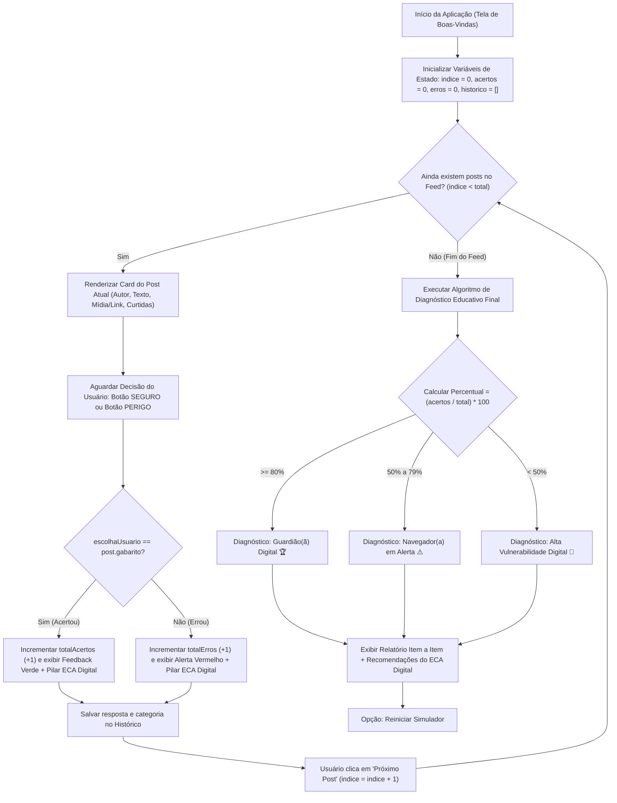

# 💻 Rascunho Técnico — Pilar de Programação (Talita Mendonça Marques)

**Projeto:** Feed Seguro: Simulador de Riscos Digitais (ECA Digital)  
**Responsável:** Talita Mendonça Marques (Integrante B — Pilar de Programação)

---

## 1. Visão Geral da Solução Programada

Para atender aos requisitos do projeto prático sobre o **ECA Digital**, a parte lógica e funcional do simulador foi estruturada em **duas versões equivalentes** (permitindo ao grupo demonstrar no notebook ou direto no celular):

1. **Versão Web Pura (`versao_web/`)**: Desenvolvida em **HTML5, CSS3 e JavaScript (ES6)**. Abre instantaneamente em qualquer navegador de celular ou computador apenas clicando duas vezes em `index.html`, simulando a moldura de um smartphone.
2. **Versão Python + Streamlit (`versao_streamlit/`)**: Desenvolvida em **Python (`app.py`)** utilizando a biblioteca **Streamlit**, conforme planejado inicialmente pelo grupo.

---

## 2. Esquema Lógico da Programação (Fluxograma do Algoritmo)

Este esquema pode ser incluído diretamente na seção **"9. Desenvolvimento / Esquemas Lógicos"** e **"14. Desenvolvimento"** do Relatório Final:



---

## 3. Estrutura das Responsabilidades Codificadas

### 3.1. Estruturação do Feed Interativo
Cada publicação do feed é armazenada como um objeto/dicionário contendo:
- `id`, `autor`, `arroba`, `avatar`, `tipo` (Anúncio, Direct/DM, Stories Público, Post Institucional);
- `texto`, `midiaTitulo`, `midiaUrl`, `curtidas`, `comentarios`;
- `gabarito` (`"SEGURO"` ou `"PERIGO"`);
- `categoria` (Golpes/Phishing, Aliciamento/Desconhecidos, Exposição de Dados, Cyberbullying, Cidadania Digital);
- `explicacao` e `pilarEca` (fundamentação educativa exibida após a resposta e no diagnóstico final).

> **Integração com o Integrante A (Leonardo):** Caso o Leonardo crie novas situações-problema, basta adicioná-las na lista `postsDoFeed` (no arquivo `script.js` ou `app.py`), sem precisar alterar nenhuma linha do algoritmo!

### 3.2. Programação das Opções de Escolha (`✅ Seguro` vs `⚠️ Perigo`)
- Os botões disparam a função `avaliarPost(escolhaUsuario)` (em JS) ou `registrar_escolha(escolha_usuario)` (em Python).
- O algoritmo bloqueia cliques duplicados, compara a resposta com o gabarito da situação-problema e apresenta um **feedback imediato** explicando o motivo de aquele post ser seguro ou perigoso.

### 3.3. Algoritmo de Contabilização e Diagnóstico Educativo Final
Ao finalizar todos os posts do feed, a função `gerarDiagnosticoEducativo()` calcula:
$$\text{Aproveitamento (\%)} = \text{round}\left(\frac{\text{Total de Acertos}}{\text{Total de Posts}} \times 100\right)$$

Com base na pontuação, o algoritmo classifica o perfil do estudante em três faixas:
1. **$\ge 80\%$ — Nível Guardião(ã) Digital:** Reconhece ameaças com segurança.
2. **$50\% \text{ a } 79\%$ — Nível Navegador(a) em Alerta:** Identifica riscos óbvios, mas ainda vulnerável a engenharia social sutil.
3. **$< 50\%$ — Nível Alta Vulnerabilidade Digital:** Necessita atenção imediata quanto a links falsos, exposição de rotina e contato com estranhos.

---

## 4. Como Executar e Testar (Para Tirar Prints da Documentação)

### Opção A: Versão Web (HTML/CSS/JS)
1. Abra a pasta `prototipo_talita/versao_web/`.
2. Dê dois cliques no arquivo `index.html` para abrir no navegador (Chrome, Edge, etc.).

### Opção B: Versão Python (Streamlit)
1. No terminal, dentro da pasta `prototipo_talita/versao_streamlit/`, execute:
   ```powershell
   pip install -r requirements.txt
   streamlit run app.py
   ```

