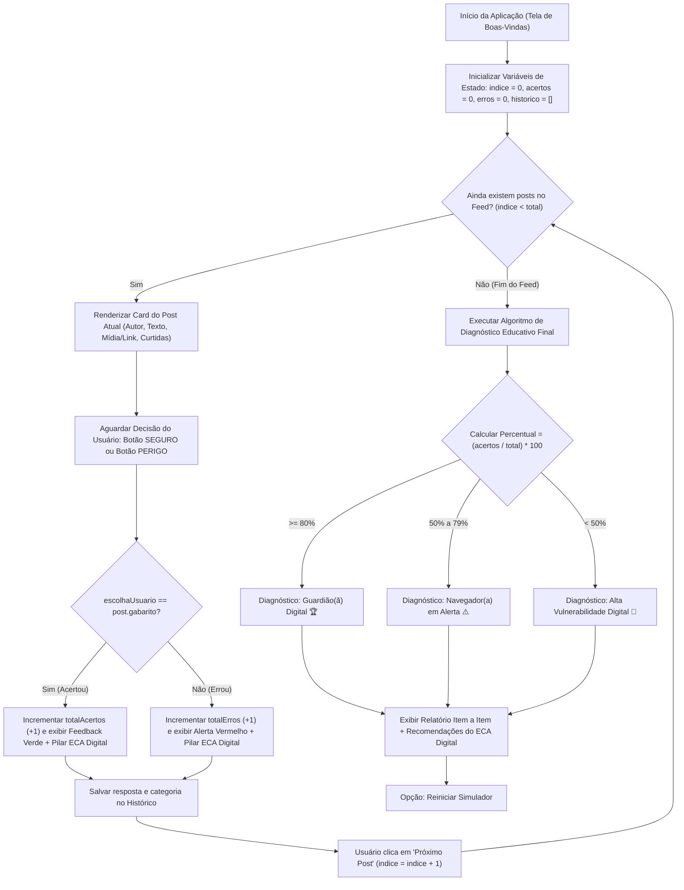

# 💻 Rascunho Técnico — Pilar de Programação (Talita Mendonça Marques)

**Projeto:** Feed Seguro: Simulador de Riscos Digitais (ECA Digital)  
**Responsável:** Talita Mendonça Marques (Integrante B — Pilar de Programação)

---

## 1. Visão Geral da Solução Programada

Para atender aos requisitos do projeto prático sobre o **ECA Digital**, a parte lógica e funcional do simulador foi estruturada em **duas versões equivalentes** (permitindo ao grupo demonstrar no notebook ou direto no celular):

1. **Versão Web Pura (`versao_web/`)**: Desenvolvida em **HTML5, CSS3 e JavaScript (ES6)**. Abre instantaneamente em qualquer navegador de celular ou computador apenas clicando duas vezes em `index.html`, simulando a moldura de um smartphone.
2. **Versão Python + Streamlit (`versao_streamlit/`)**: Desenvolvida em **Python (`app.py`)** utilizando a biblioteca **Streamlit**, conforme planejado inicialmente pelo grupo.

---

## 2. Esquema Lógico da Programação (Fluxograma do Algoritmo)

Este esquema pode ser incluído diretamente na seção **"9. Desenvolvimento / Esquemas Lógicos"** e **"14. Desenvolvimento"** do Relatório Final:



---

## 3. Estrutura das Responsabilidades Codificadas

### 3.1. Estruturação do Feed Interativo
Cada publicação do feed é armazenada como um objeto/dicionário contendo:
- `id`, `autor`, `arroba`, `avatar`, `tipo` (Anúncio, Direct/DM, Stories Público, Post Institucional);
- `texto`, `midiaTitulo`, `midiaUrl`, `curtidas`, `comentarios`;
- `gabarito` (`"SEGURO"` ou `"PERIGO"`);
- `categoria` (Golpes/Phishing, Aliciamento/Desconhecidos, Exposição de Dados, Cyberbullying, Cidadania Digital);
- `explicacao` e `pilarEca` (fundamentação educativa exibida após a resposta e no diagnóstico final).

> **Integração com o Integrante A (Leonardo):** Caso o Leonardo crie novas situações-problema, basta adicioná-las na lista `postsDoFeed` (no arquivo `script.js` ou `app.py`), sem precisar alterar nenhuma linha do algoritmo!

### 3.2. Programação das Opções de Escolha (`✅ Seguro` vs `⚠️ Perigo`)
- Os botões disparam a função `avaliarPost(escolhaUsuario)` (em JS) ou `registrar_escolha(escolha_usuario)` (em Python).
- O algoritmo bloqueia cliques duplicados, compara a resposta com o gabarito da situação-problema e apresenta um **feedback imediato** explicando o motivo de aquele post ser seguro ou perigoso.

### 3.3. Algoritmo de Contabilização e Diagnóstico Educativo Final
Ao finalizar todos os posts do feed, a função `gerarDiagnosticoEducativo()` calcula:
$$\text{Aproveitamento (\%)} = \text{round}\left(\frac{\text{Total de Acertos}}{\text{Total de Posts}} \times 100\right)$$

Com base na pontuação, o algoritmo classifica o perfil do estudante em três faixas:
1. **$\ge 80\%$ — Nível Guardião(ã) Digital:** Reconhece ameaças com segurança.
2. **$50\% \text{ a } 79\%$ — Nível Navegador(a) em Alerta:** Identifica riscos óbvios, mas ainda vulnerável a engenharia social sutil.
3. **$< 50\%$ — Nível Alta Vulnerabilidade Digital:** Necessita atenção imediata quanto a links falsos, exposição de rotina e contato com estranhos.

---

## 4. Links Oficiais (Deploy em Nuvem) e Execução Local

* 🌐 **Versão Web Mobile (GitHub Pages):** https://skyzinha-chan.github.io/feed-seguro-eca-digital/versao_web/
* 🐍 **Versão Python (Streamlit Cloud):** https://feed-seguro-eca-digital.streamlit.app/
* 📂 **Repositório Oficial no GitHub:** https://github.com/skyzinha-chan/feed-seguro-eca-digital

### Execução Local (Opcional)
* **Versão Web:** Abra `prototipo_talita/versao_web/index.html` no navegador.
* **Versão Python (Streamlit):**
  ```powershell
  python -m pip install -r prototipo_talita/versao_streamlit/requirements.txt
  python -m streamlit run prototipo_talita/versao_streamlit/app.py
  ```

---

## 5. Onde Atualizar Conforme os Colegas Entregarem as Partes Deles

### 5.1. No Código-Fonte (Integração Técnica)
1. **Quando o Leonardo (Integrante A — Conteúdo/ECA Digital) enviar novas situações-problema:**
   * Na **Versão Web**: atualizar a lista `postsDoFeed` no início do arquivo [`versao_web/script.js`](./versao_web/script.js).
   * Na **Versão Streamlit**: atualizar a lista `POSTS_DO_FEED` no arquivo [`versao_streamlit/app.py`](./versao_streamlit/app.py).
2. **Quando o Adriano (Integrante C — Visual/Design) enviar imagens, cores ou banners:**
   * Na **Versão Web**: atualizar as cores/estilos em [`versao_web/style.css`](./versao_web/style.css) e a estrutura em [`versao_web/index.html`](./versao_web/index.html).
   * Na **Versão Streamlit**: atualizar o bloco `<style>` no topo de [`versao_streamlit/app.py`](./versao_streamlit/app.py).
3. **Para atualizar os links online (GitHub Pages e Streamlit Cloud) após qualquer mudança:**
   Basta rodar no terminal (dentro da pasta `prototipo_talita`):
   ```bash
   git add .
   git commit -m "atualiza posts e visual"
   git push
   ```
   *(Tanto o site do GitHub Pages quanto o `feed-seguro-eca-digital.streamlit.app` atualizam sozinhos em segundos após o `git push`!)*

---

## 6. Diário de Evolução e Testes da Programação (Para o Relatório Final — Itens 12 a 18)

*(Vá preenchendo os tópicos abaixo conforme o grupo avançar para entregar ao Denner e ao Adriano no Relatório Final)*:

* **Versão escolhida pelo grupo após votação:** `[ ] Versão Web (HTML/JS)` / `[ ] Versão Python (Streamlit)` / `[ ] Ambas`
* **Integração com o Conteúdo (Leonardo):**
  * *Data:* **20/10/2026** — *O que foi ajustado nos posts:* Foram **adicionados aos 6 cenários iniciais da Talita** os **10 novos cenários oficiais do ECA Digital** elaborados pelo Leonardo (totalizando **16 situações-problema** tanto em `versao_web/script.js` quanto em `versao_streamlit/app.py`):
    1. *Suspensão e Conteúdo Nocivo (Caso Discord)* (`@comunidade_secreta` — **PERIGO**);
    2. *Coleta Ilegal de Dados e Publicidade* (`@quiz_divertido_br` — **PERIGO**);
    3. *Informação Segura* (`@safernet_oficial` — **SEGURO**);
    4. *Jogos de Apostas e Publicidade Ilegal* (`@influencer_milionario` — **PERIGO**);
    5. *Superexposição e Vigilantismo* (`@vlog_da_bia` — **PERIGO**);
    6. *Discurso de Ódio / Racismo* (`@verdade_oculta_00` — **PERIGO**);
    7. *Informação Científica Segura* (`@cetic_br_oficial` — **SEGURO**);
    8. *Cyberbullying / Exposição de Imagens Íntimas* (`@fofocas_da_escola` — **PERIGO**);
    9. *Fraudes Bancárias Digitais (Golpes)* (`@atendimento_banco_seguro` — **PERIGO**);
    10. *Uso Consciente e Defesa do Consumidor* (`@ministerio_justica` — **SEGURO**).
* **Integração com o Design (Adriano):**
  * *Data:* ___/___/2026 — *O que foi ajustado na interface:* (ex.: "Foram inseridas novas cores/ícones nos cards do feed").
* **Registro de Testes e Correções (Ciclo IDEIA → PROTÓTIPO → TESTE → CORREÇÃO → RESULTADO):**
  1. *A aplicação web funciona sem travar?* Sim, testada via deploy em nuvem no celular e computador.
  2. *O usuário consegue entender como classificar os posts?* (Anotar feedback dos testes com colegas/adolescentes).
  3. *O diagnóstico educativo final está sendo gerado corretamente?* Sim, contabilizando acertos, erros e percentual com feedback por post.
  4. *Dificuldades encontradas na programação e soluções:* (ex.: "Configuração inicial do ambiente Streamlit e deploy em nuvem resolvidos via repositório GitHub e Streamlit Community Cloud").


